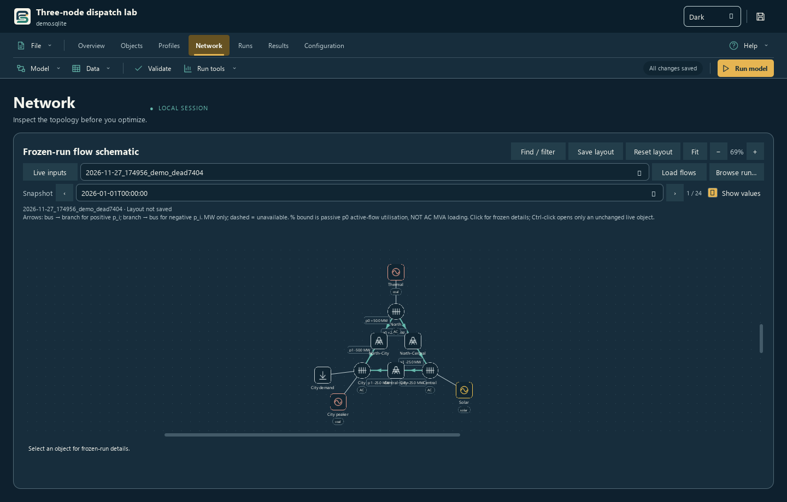
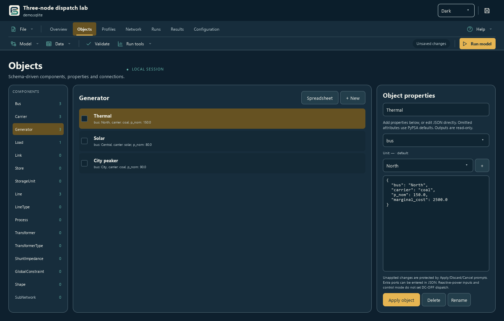
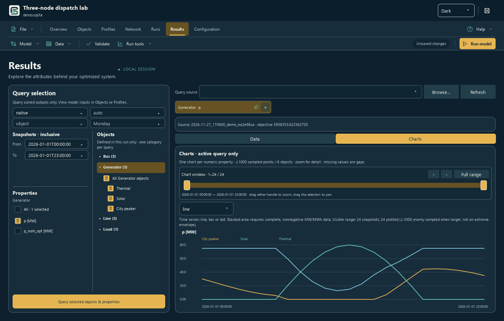

# PyPSA Studio

**A desktop workbench for building, solving, and exploring energy-system models with PyPSA.**

PyPSA Studio brings model editing, network inspection, optimization, and results analysis into one local application. Use it to study dispatch, storage operation, and network constraints without writing a Python script for every run. When you need a script, Studio can export one for standalone replay.

[Download the source preview](https://github.com/mr-techieX/pypsa-studio/releases/tag/v1.3.1-preview) · [Release notes](RELEASE_NOTES.md) · [MIT license](LICENSE)



*Network visualizer: follow solved active-power flows for a selected snapshot in the bundled Three-node dispatch lab.*

## What you can do

| Workflow | Capabilities |
| --- | --- |
| **Build** | Define buses, generators, loads, lines, transformers, links, and storage. Edit properties in forms or a spreadsheet, import CSV time profiles, and use built-in attribute help. |
| **Inspect** | Explore the network schematic, review connections, and use model validation before solving. |
| **Solve** | Run a single optimization or a sequential study that carries supported operating states between windows. Compare scenario runs and optionally export the LP or MPS formulation. |
| **Analyze** | Query solved outputs such as dispatch, line flows, storage levels, and optimized capacity. Filter by time, pin views, chart results, and export CSV or calendar summaries. |

## What makes it useful

- **Revisit the model you actually solved.** Studio freezes a copy of the inputs with each run, so you can inspect past results without confusing them with later model edits.
- **Share results without sharing the project.** Drop a standalone PyPSA `solution.nc` into Studio to query stored outputs read-only, without the original project database or CSV files.
- **Replay beyond the desktop.** Export `model.py` for a single solve or `run.py` and step scripts for sequential execution. A successful sequential replay produces a combined `solution.nc` in a new replay folder.
- **Keep the workflow local.** Projects use SQLite, solves run locally, and the demo library lets you explore the app without importing your own data.

## Quick start

The current preview is a **source distribution**, not an installer. The release was smoke-tested on Windows with Python 3.14 in an existing environment; a clean-machine installation was not verified.

1. Download `pypsa-studio-1.3.1-preview-source.zip` from the [preview release](https://github.com/mr-techieX/pypsa-studio/releases/tag/v1.3.1-preview) and extract it, or clone this repository.
2. From the extracted folder or repository root, run these commands in PowerShell:

   ```powershell
   python -m venv .venv
   .\.venv\Scripts\python.exe -m pip install -r requirements.txt
   .\.venv\Scripts\python.exe -m energy_gui
   ```

   Use `python -m energy_gui` directly if you already have an environment with the listed dependencies. The bundled `.cmd` and `.ps1` launchers assume the original workspace layout.

### Try your first study

1. In **Overview**, choose **Load demo model…** and select a demo.
2. Review the model in **Objects** or **Network**, then save it as a SQLite project.
3. In **Runs**, choose an execution mode and select **Start**. Enable **Save as Python run** if you also want a standalone replay script.
4. In **Results**, select an object and a solved output—for example, a generator and `p` for dispatch. Set a snapshot range and run the query to view the table or chart.

To revisit a saved solve, select it from **Run history**. To open only the result archive, use **File → Open results (.nc)…**. When moving a Studio project, keep its SQLite file and accompanying `runs/` folder together.

### Studio in action

| Edit a model | Explore solved dispatch |
| --- | --- |
| [](docs/media/studio-model-editor.png) | [](docs/media/studio-dispatch-results.png) |
| Inspect and edit generator properties in **Objects**. | Compare hourly generator output in the **Results** chart. |

## Technology stack

| Layer | Technology |
| --- | --- |
| Desktop interface | Python, PySide6, and Qt Quick (QML) |
| Energy-system modeling | [PyPSA](https://pypsa.org/) |
| Optimization | [Linopy](https://linopy.readthedocs.io/) for model formulation; [HiGHS](https://highs.dev/) for solving |
| Data handling and storage | pandas, SQLite project files, NetCDF solution archives, and CSV tables and reports |

## Documentation

- [Demo models](docs/DEMO_MODELS.md) and [network navigation](docs/NETWORK_PLAYGROUND.md)
- [Run modes and sequential execution](docs/HORIZON_EXECUTION.md) and [run-folder structure](docs/RUN_FILES.md)
- [Standalone NetCDF results](docs/NETCDF_RESULTS.md) and [calendar aggregation](docs/TEMPORAL_RESULTS.md)
- [Standalone Python replay](docs/PYTHON_REPLAY.md)

## Scope and license

Studio supports linear energy-system optimization workflows. Its results do not certify AC feasibility or engineering suitability. Sequential runs solve separate windows with state handoffs, not one full-horizon optimum. Standalone archives can only show outputs stored in the file. This preview does not include PLEXOS import/export or a bundled runtime.

Original PyPSA Studio material is licensed under the [MIT License](LICENSE). The bundled PGLib demo data remains under CC BY 4.0; see the [third-party notices](THIRD_PARTY_NOTICES.md).
